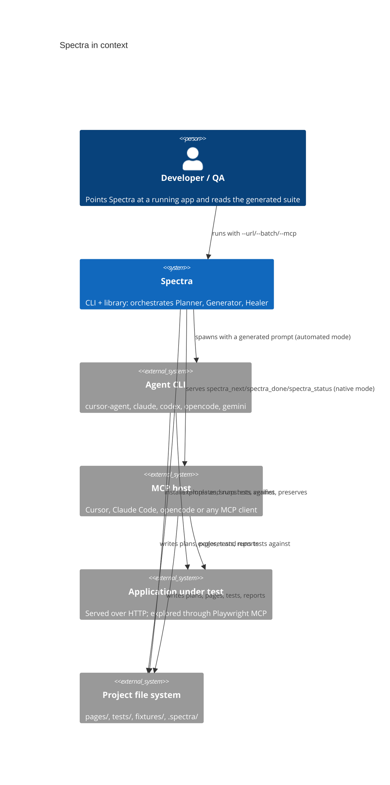
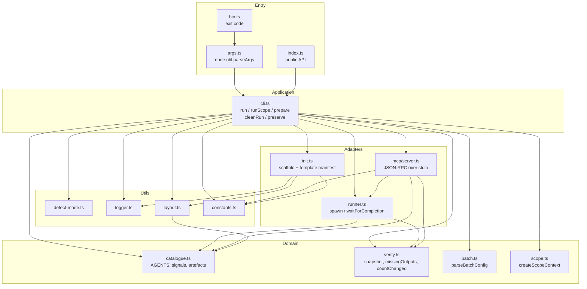
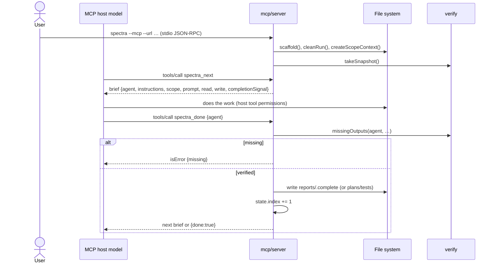

# Project Architecture Blueprint — Spectra

**Generated:** 2026-11-10
**Scope:** the whole repository (`src/`, `templates/`, `specs/`, `docs/`, `tests/`, `pages/`)
**Detected stack:** TypeScript 6 / Node.js ≥ 20 ESM, pnpm, Playwright (peer), Vitest, Biome, Changesets
**Detected pattern:** modular monolith — a layered CLI/library core (command → orchestration → domain modules → utilities) with a file-system contract as its integration surface, plus an interchangeable external "AI runtime" (agent CLI or the host's MCP model).

This document describes the architecture **as implemented**, not as imagined. Where the code and a doc disagree, the code is quoted.

---

## 1. Architecture detection and analysis

### 1.1 What the repository is

`package.json` describes a dual-purpose package:

- **CLI** — `bin.spectra → dist/bin.js`, one command with modes `--init`, `--batch`, `--mcp`, `--manual`, `--mode`, `--debug`.
- **Library** — `main/types/exports → dist/index.js|d.ts`, exposing `run()`, `detectMode()`, `createScopeContext()`, `DEFAULT_OUTPUT_DIR`, `TEMPLATE_DIR`.

It is **not** a web app. Its runtime artefacts are files in the consumer's project:

```
<project>/
  .spectra/agents/{planner,generator,healer,shared}/   installed prompts
  .spectra/output/plans/test-plan.md
  .spectra/output/reports/{results.json,healing-report.md,status.json}
  .spectra/output/scopes/<n>-<slug>/                   per-Scope copies
  pages/*.ts  tests/*.spec.ts  fixtures/pages.ts       generated code
```

### 1.2 Evidence used

| Signal | Finding |
|---|---|
| Directory layout | `src/{agents,mcp,utils}` is a flat, feature-oriented core; `templates/` is a second, shipped tree of the same concepts |
| Imports | All relative, `.js`-suffixed (NodeNext ESM). No DI container, no framework, no runtime deps |
| `package.json` | Zero `dependencies`; only peer `@playwright/test`; dev-only build/test/lint tooling |
| Configuration | CLI flags and env vars only (`SPECTRA_URL`, `SPECTRA_MODE`, `SPECTRA_DEBUG`, plus `SPECTRA_BROWSERS`/`SPECTRA_TAGS`/`SPECTRA_SKIP_WEBSERVER` read by `playwright.config.ts`) |
| Persistence | The file system is the database; there is no other store |
| Boundaries | `src/agents/catalogue.ts` is the single description of the pipeline; `src/agents/verify.ts` is the single answer to "did this Agent do its job?" |
| Evolution markers | `docs/adr/0001..0003`, `plans/001..027` (plans, some with execution reports), `.changeset/` |

### 1.3 Architectural pattern

The dominant pattern is **layered + ports-and-adapters at one seam**:

1. **Entry layer** — `bin.ts`, `args.ts`, `index.ts`.
2. **Application/orchestration layer** — `cli.ts` (`run`, `runScope`, `prepare`, `cleanRun`, `preserve`).
3. **Domain layer** — `agents/catalogue.ts` (what the pipeline is), `agents/verify.ts` (the completion rule), `utils/batch.ts` (the Batch grammar), `utils/scope.ts` (Scope rendering).
4. **Adapter layer** — `agents/runner.ts` (spawns one of six agent CLIs, or waits in manual mode), `mcp/server.ts` (serves the same pipeline to a host model over stdio JSON-RPC), `agents/init.ts` (template installation into the consumer project).
5. **Infrastructure utilities** — `logger.ts`, `constants.ts`, `layout.ts`, `detect-mode.ts`.

The adapter seam is deliberate: `runner.ts` and `mcp/server.ts` both consume `Agent` records and both call `verify.missingOutputs`, so the automated and native modes cannot drift on what an Agent owes.

---

## 2. Architectural overview

### 2.1 Guiding principles visible in the code

1. **One description, many consumers.** `AGENTS` in `src/agents/catalogue.ts` drives prompts (`buildPrompt`), log names, cleanup (`cleanRun`), directory creation (`OUTPUT_DIRS`/`PROJECT_DIRS`), verification (`takeSnapshot`/`missingOutputs`), and MCP briefs. ADR 0001 records the trade-off: templates still name paths, and a test enforces agreement rather than a generator.
2. **The run must never pass on work it did not do.** `takeSnapshot` records mtimes before the pipeline; `missingOutputs` accepts only new-or-changed files. ADR 0003 explains why "file exists" was rejected.
3. **The file system is the pipeline's protocol.** Agents communicate through Markdown/JSON artefacts and completion-signal files, never through a shared process. That is what makes five agent CLIs, manual mode and an MCP host interchangeable.
4. **Library-safe core.** `run()` returns `boolean` and never exits. The only `process.exit` calls are `bin.ts` on failure and `args.ts` for `--help`. `parseBatchConfig` is pure. Exceptions are caught at the orchestration boundary and turned into log lines.
5. **Trust boundary is explicit, not implicit.** Automated Agents run with full permission; the code warns when `--file` points outside the project (`warnOnUntrustedFile`) and comments the residual risk in `runner.ts`.
6. **User edits win.** `installTemplates` tracks installed hashes in `.templates.json` and keeps a modified file, printing the new template path instead.
7. **Lazy infrastructure.** No database, no queue, no server except a 289-line stdio JSON-RPC handler. Runtime dependency count is zero.

### 2.2 Boundaries

| Boundary | Inside | Outside |
|---|---|---|
| Process | Spectra CLI/library, its logs | Agent CLIs (`cursor-agent`, `claude`, `codex`, `opencode`, `gemini`), MCP host |
| Trust | Project root | Scope files outside it, agent CLI permissions, target app |
| Contract | `.spectra/` layout, `tests/`, `pages/`, `fixtures/` | Consumer's `playwright.config.ts`, app under test |
| Build | `src/` → `dist/` | `templates/`, `specs/`, `docs/`, `assets/` shipped verbatim |

### 2.3 Hybrids and adaptations

- **MCP mode is a third adapter, not a fourth Agent.** It reuses `buildPrompt`, `missingOutputs`, the catalogue and the scope file; it adds session state (`McpState.index`) and writes the completion signal itself when `spectra_done` passes verification.
- **Batch mode is a loop, not a scheduler.** No concurrency, no retries, no resume; sequential `for` with per-Scope result folders.
- **Generated tests are checked in.** `tests/` and `pages/` at repo root are the dogfooding output against `dummy-test-app/`, and both are typechecked by `tsconfig.test.json`.

---

## 3. Architecture visualization

### 3.1 C4 — System context



### 3.2 C4 — Containers (inside Spectra)



Dependency direction is mostly downward: Entry → Application → Domain/Adapters → Utils. The two deliberate upward edges are `layout.ts → catalogue.ts` (derive directories from the Agents) and `mcp/server.ts → runner.ts` (reuse `buildPrompt`). There are **no cycles**; that MCP → runner import is the only adapter-to-adapter dependency.

### 3.3 Data flow — one automated run

```mermaid
sequenceDiagram
  actor U as User
  participant CLI as cli.runScope
  participant FS as File system
  participant R as runner.runAgent
  participant A as Agent CLI
  participant V as verify

  U->>CLI: spectra --url …
  CLI->>FS: mkdir .spectra/output/{plans,reports,tests,test-results}
  CLI->>FS: initAgents() → .spectra/agents/**
  CLI->>FS: cleanRun() → delete signals, artefacts, results.json, logs
  CLI->>FS: createScopeContext() → shared/current-scope.md
  CLI->>V: takeSnapshot(AGENTS, outputDir, cwd)
  loop each Agent in AGENTS (planner → generator → healer)
    CLI->>R: runAgent(agent, ctx)
    R->>R: buildPrompt(agent, ctx)
    R->>A: spawn(bin, args, {stdio: inherit|pipe})
    A->>FS: writes artefacts + project files + completion signal
    A-->>R: exit 0
    R-->>CLI: resolve
    CLI->>V: missingOutputs(agent, …)
    alt missing
      CLI->>CLI: ok = false; break
    else done and batch scope
      CLI->>FS: preserve() copies agent.outputs → scopes/<n>-<slug>/
    end
  end
  CLI->>V: countChanged(pages, '.ts'), countChanged(tests, '.spec.ts')
  CLI-->>U: summary + exit code
```

### 3.4 Data flow — MCP (native) mode



---

## 4. Core architectural components

### 4.1 Agent catalogue — `src/agents/catalogue.ts` (73 lines)

**Purpose.** The canonical structural description of the Spectrum. An `Agent` is a record of name, colour, emoji, `inputs`, `outputs` (relative to the output dir), `projectOutputs` (prompt-level project paths), `writes` (folders the run verifies) and `completionSignal`.

**Internal structure.** Three literal records:

| Agent | inputs | outputs | projectOutputs | writes (verified) | signal |
|---|---|---|---|---|---|
| planner | — | `plans/test-plan.md` | — | — | `plans/.complete` |
| generator | `plans/test-plan.md` | — | `pages/`, `tests/`, `fixtures/pages.ts` | `tests/` | `tests/.complete` |
| healer | `reports/results.json` | `reports/healing-report.md`, `reports/status.json` | `pages/`, `tests/` | — | `reports/.complete` |

**Interaction.** Consumed by `cli.ts`, `runner.ts`, `mcp/server.ts`, `utils/layout.ts`, and enforced against templates by `src/agents/__tests__/catalogue.test.ts`.

**Extension.** Add an Agent by appending one record; prompts, cleanup, directory creation and verification follow automatically. **Caveat (deliberate, documented in the file):** `projectOutputs` is prompt-only; only `writes` folders and `outputs` files are verified. The Generator's `pages/` and `fixtures/pages.ts` are therefore *not* checked, and the Healer's edits to `tests/` are not checked either.

### 4.2 Verification — `src/agents/verify.ts` (129 lines)

**Purpose.** The single completion rule shared by both adapters.

**Key abstractions.**
- `Snapshot = Map<absolutePath, Fingerprint | undefined>`; a `Fingerprint` is the mtime and the SHA-1 of the content.
- `takeSnapshot` records every `agent.outputs` file (absent when it does not exist) and every file under each folder in `writes ∪ projectOutputs` that ends with `/`.
- `changedSince` accepts a file when it is absent from the snapshot, or when its time or its content changed.
- `missingOutputs` checks `outputs` file-by-file and `writes` folder-by-folder (one changed file is enough).
- `countChanged` powers the summary and excludes `.d.ts`.
- `projectPath` is the single path-presentation helper (relative to `process.cwd()`).

**Known limits.** a rewrite with the same bytes in the same clock tick is invisible (annotated with `shortcut:`); the snapshot is per-run, not per-Scope, so a Batch reuses one snapshot (correct, because `cleanRun` removes artefacts between Scopes); `process.cwd()` is read at call time rather than injected.

### 4.3 Runner — `src/agents/runner.ts` (209 lines)

**Purpose.** Turn an `Agent` + `RunContext` into an executed CLI invocation (or a waiting manual step).

**Internal structure.**
- `buildPrompt` assembles five labelled lines (`SCOPE`, `INSTRUCTIONS`, optional `READ`, optional `WRITE TO`, `When complete, create:`) entirely from catalogue fields and `projectPath`.
- `runAgentCli` spawns with `stdio: ['inherit', 'pipe', 'pipe']`, tees both pipes into `.spectra/output/<agent>.log`, mirrors them when `--debug`, and rejects on non-zero exit. Pipes are always drained (documented: an unread pipe would block the agent).
- `waitForCompletion` polls every 500 ms up to 30 minutes for manual mode.
- The `switch (mode)` is the only place that knows CLI-specific flags.

**Trust note.** The comment above the switch states the residual risk: every automated mode runs its CLI with full permission; `warnOnUntrustedFile` in `cli.ts` is the only mitigation.

**Lifecycle detail.** After a successful CLI exit, `runAgent` only *warns* if the completion signal is absent; it does not throw. The orchestration layer's `missingOutputs` check is what actually fails the run.

### 4.4 Initialiser / template installer — `src/agents/init.ts` (184 lines)

**Purpose.** Install the shipped templates into a consumer project without destroying user edits.

**Mechanisms.**
- `scaffold` creates `PROJECT_DIRS`, installs `templates/agents` and `templates/docs`, copies the gate docs from the package's `specs/`, then `copyIfMissing` for `fixtures/pages.ts`, `playwright.config.ts`, `.cursor/mcp.json`, `.mcp.json`, `tests/seed.spec.ts`, `.github/workflows/test.yml`.
- `installTemplates` walks the source tree, hashes each file (`sha256`), and keeps a destination file whose current hash differs from the installed hash; it records the *new* template hash in `next[key]` so the next upgrade compares against what was actually shipped.
- Orphan cleanup removes a destination file only if it still matches the last installed hash.
- `insideDest` rejects manifest keys that resolve outside the destination — a path-traversal guard added by `plans/009` and covered by tests.

**Manifest.** `.templates.json` inside each destination folder (`.spectra/agents/`, `docs/`, `specs/`), gitignored for `docs/` in this repo.

### 4.5 CLI orchestration — `src/cli.ts` (421 lines)

**Purpose.** The application service. It owns every side effect that is not an adapter detail.

**Responsibilities, in order of `run()`:**
1. `--mcp` → `runAsMcpServer` (stdout becomes JSON-RPC; logs move to stderr via `setLogTarget('stderr')`).
2. `--init` → `scaffold` + next-steps text.
3. `--batch` → resolve/validate file, resolve URL precedence (`--url` → batch `url` → `SPECTRA_URL`), delete `.spectra/output/scopes/`, `prepare()` once, warn for every scope file, then loop `runScope` with per-Scope folder `${i+1}-${slugify(label)}`.
4. default → `prepare()` then `runScope`.

`runScope` does the per-run work: URL check, output-dir creation, banner, scope context, `cleanRun`, snapshot, Agent loop with break-on-failure, `preserve` after each verified Agent when batching, and summary counts.

**Flag precedence.** In Batch, shared CLI flags override per-Scope fields (`options.page ?? scopeDef.page`, etc.). `--manual` beats everything and forces `manual`; otherwise `--mode` wins over auto-detection; `SPECTRA_MODE` is the CLI default in `args.ts`.

**Side-effect inventory.** `mkdir`, `rm`, `copyFile`, `writeFile`, `readFile`, `spawn`, `execSync` (mode detection only), `process.cwd`, `process.exit` (`bin.ts` on failure, `args.ts` for `--help`).

### 4.6 MCP adapter — `src/mcp/server.ts` (289 lines)

**Purpose.** Let the model the user is already talking to perform the Agent work, with Spectra keeping the bookkeeping.

**Protocol subset.** `initialize`, `notifications/initialized`, `notifications/cancelled`, `ping`, `tools/list`, `tools/call`; newline-delimited JSON-RPC on stdio; parse errors → `-32700`, unknown method → `-32601`. Protocol version is pinned to `2024-11-05`.

**Tools.**
- `spectra_next` → full brief (instructions file, scope context, generated prompt, read/write lists, completion signal).
- `spectra_done {agent}` → rejects a wrong agent name and any `missingOutputs`; on success writes the signal, advances `index`, returns the next brief or `{done:true}`.
- `spectra_status` → current agent, finished list, output dir.

**Design choice.** No model call, no API key, no network. The host supplies the intelligence; this module supplies ordering and verification. `serveMcp` takes streams as parameters so tests run it without a process.

**State.** `McpState` is mutable and single-session; index and snapshot live for the life of the process. There is no transport beyond stdio and no resource/prompt capability.

### 4.7 Utilities

| Module | Role | Notable decisions |
|---|---|---|
| `batch.ts` | Pure parse/validate of the Batch JSON | Unknown keys are errors (a misspelled `scope` would silently widen the run); discriminated result `{ok:true}|{ok:false}`; no fs, no exit |
| `scope.ts` | Render `.spectra/agents/shared/current-scope.md` | `oneLine()` collapses whitespace so file content cannot inject prompt structure; embedded requirements are fenced ```` ```md ````; `fullUrl` avoids double/missing slashes |
| `detect-mode.ts` | Choose the CLI mode | Explicit order `cursor-agent > claude > codex > opencode > gemini > manual`; a requested mode must be known *and* installed; `manual` needs no binary |
| `logger.ts` | Colourised output | Lazy `isDebug()` (env set after import); `setLogTarget('stderr')` for MCP; `error` always writes to stderr |
| `layout.ts` | Derive directories from the catalogue | `OUTPUT_DIRS` = dirs of signals/artefacts + `test-results`; `PROJECT_DIRS` adds `tests`, `specs`, `pages`, `fixtures`, agent dirs and the output dirs |
| `constants.ts` | Package paths | `PACKAGE_ROOT` resolved from `import.meta.url` two levels above `dist/utils/`; `DEFAULT_OUTPUT_DIR = '.spectra/output'` |

---

## 5. Layers and dependencies

### 5.1 Layer map

| Layer | Modules | May import |
|---|---|---|
| Entry | `bin.ts`, `args.ts`, `index.ts` | Application, Utils |
| Application | `cli.ts` | Domain, Adapters, Utils |
| Domain | `catalogue.ts`, `verify.ts`, `batch.ts`, `scope.ts` | Domain (`verify` imports the `Agent` type from `catalogue`) or Utils (`scope` imports `logger`); `batch` imports nothing local |
| Adapters | `runner.ts`, `mcp/server.ts`, `init.ts` | Domain, Utils; `mcp` also imports `buildPrompt` from `runner` |
| Utils | `logger.ts`, `constants.ts`, `layout.ts`, `detect-mode.ts` | `layout` → Domain (catalogue) only |

### 5.2 Rules enforced by construction

- **Adapters stay siblings except one reuse.** `mcp/server.ts` imports `buildPrompt` from `runner.ts` so the brief and the CLI prompt cannot diverge; otherwise no adapter imports another.
- **Domain code has few side effects.** `parseBatchConfig` is pure; `catalogue` is data; `verify.ts` only reads the file system; `scope.ts` writes exactly one file and is the only domain module that writes.
- **`cli.ts` is the composition root.** It is the only module that constructs `McpState`, the only caller of `scaffold`, `cleanRun` and `preserve`, and the only place that decides the order of a run.
- **The pipeline never exits.** `run()` reports through its return value; only `bin.ts` exits on failure and `args.ts` exits for `--help`. This is what makes `run()` library-safe (plan 008).
- **Verification has one home.** `missingOutputs` is imported by both `cli.ts` and `mcp/server.ts`; neither reimplements the rule.

### 5.3 Violations and smell inventory

| Location | Observation | Impact |
|---|---|---|
| `runner.ts` `switch (mode)` + `detect-mode.ts` `AGENT_BIN` | CLI command names live in two places | Adding a mode means editing both; a test could pin the agreement |
| `cli.ts` `runAsMcpServer` | Duplicates output-dir creation, `cleanRun`, scope creation and trust warning from `runScope` | Two setup paths can drift; today they agree |
| `cli.ts` | Reads `process.cwd()` in four functions instead of receiving a root | Harder to unit-test multi-project scenarios; `RunContext` already carries `outputDir`/`agentsDir` but not `projectRoot` (MCP state does) |
| `logger.error` | Bypasses the configurable `out` and always uses `console.error` | In normal mode errors are separated from stdout; intentional, but means `setLogTarget` does not affect errors |
| `package.json` `files` | Ships `specs/` and `docs/` but not `templates/.github` explicitly (covered by `templates`) | Fine today; the consumers of `PACKAGE_ROOT/specs` depend on packaging |
| `cli.ts` summary | Prints `npx playwright …` even for pnpm projects | Cosmetic/docs drift risk (plan 013 addressed adjacent wording) |

---

## 6. Data architecture

### 6.1 Domain model

```
Batch ──1..*── ScopeDefinition ──(resolved)──> Scope ──> current-scope.md
  └ url?                                             └ Agent prompts

Agent (catalogue record)
  ├ inputs:   string[]   (output-dir relative)
  ├ outputs:  string[]   (output-dir relative, verified)
  ├ projectOutputs: string[]  (project relative, prompt only)
  ├ writes:   string[]   (project relative, folder must gain a file)
  └ completionSignal: string

Snapshot = Map<absolutePath, mtimeMs>
RunContext = {mode, outputDir, agentsDir, debug}
McpState   = {outputDir, agentsDir, projectRoot, agents[], index, snapshot}
```

There is no ORM, no schema library and no migration system. `Scope` and `Batch` are plain interfaces; validation for the Batch is hand-written and strict; validation for CLI input is `node:util`'s `parseArgs` with `strict: true`.

### 6.2 Persistence layout and ownership

| Path | Writer | Reader | Lifecycle |
|---|---|---|---|
| `.spectra/agents/**` | `init.ts` (templates) | Agents, `runner.buildPrompt`, MCP brief | installed/upgraded per run, user edits preserved |
| `.spectra/agents/shared/current-scope.md` | `scope.ts` | Planner/Generator/Healer, MCP brief | rewritten every Scope |
| `.spectra/output/plans/test-plan.md` | Planner | Generator | deleted at run start |
| `.spectra/output/reports/results.json` | `playwright.config.ts` (JSON reporter) | Healer | deleted at run start |
| `.spectra/output/reports/healing-report.md`, `status.json` | Healer | user, `preserve` | deleted at run start |
| `.spectra/output/{plans,tests,reports}/.complete` | Agent / MCP `spectra_done` | `runner.waitForCompletion`, humans | deleted at run start |
| `.spectra/output/<agent>.log` | `runner.runAgentCli` | debugging | deleted at run start |
| `.spectra/output/scopes/<n>-<slug>/**` | `cli.preserve` | user | folder tree removed at batch start; individual folder removed before reuse |
| `pages/`, `tests/`, `fixtures/pages.ts` | Generator/Healer | Playwright, `countChanged`, typecheck | user-owned, never cleaned |
| `.templates.json` | `init.installTemplates` | next `installTemplates` | append/rewrite |

### 6.3 Data access patterns

- **Recursive folder walk** — `verify.listFiles` returns `[]` on any read error, making absent folders equivalent to empty ones. It is synchronous and unbounded; fine for test projects.
- **mtime and content as change journal** — the snapshot is the only "history". A file counts as changed when its time or its SHA-1 changed; a rewrite with the same bytes in the same tick stays invisible (the `shortcut:` comment names the upgrade path).
- **Copy-on-verify for Batch** — `preserve` copies `agent.outputs` only; `reports/results.json` and generated project files are *not* copied (ADR 0002 states the cost explicitly).
- **Clean-then-run** — `cleanRun` removes signals, artefacts, `results.json` and logs before every Scope. Deletion precedes creation rather than relying on overwrite semantics.
- **Atomicity** — none. A crash can leave a partial plan, a stale signal or half-installed templates. Each subsequent run cleans the outputs; templates are re-copied from the package. There is no lock, so two concurrent runs in one project would interfere.

### 6.4 Validation at boundaries

| Boundary | Mechanism | Failure mode |
|---|---|---|
| CLI args | `parseArgs({strict:true})` | Node throws; `bin` exits non-zero |
| Unknown `--mode` / missing binary | `detectMode` throws | `prepare()` logs and returns `null` |
| Batch file | `parseBatchConfig` (JSON shape, known keys, types, non-empty scopes) | logged `Invalid batch file …`, exit non-zero |
| Missing URL | explicit checks | logged usage hint, exit non-zero |
| Scope file path | `warnOnUntrustedFile` | warning only (deliberate; the file is data, not code) |
| Template manifest | `insideDest` | path ignored with a warning |
| Agent completion | `missingOutputs` | run marked failed, next Agent not started |
| MCP requests | JSON parse guard, unknown tool → `isError`, unknown method → `-32601` | error result, session continues |

---

## 7. Cross-cutting concerns

### 7.1 Authentication and authorisation

There is none in the conventional sense. The security model is **process and file-system trust**:

- Automated modes spawn the agent CLI with permissions bypassed (`--force`, `--permission-mode bypassPermissions`, `--full-auto`, `--auto`, `--approval-mode=yolo`).
- The documented trust boundary is the project folder (README "Trust"). `warnOnUntrustedFile` warns when `--file` resolves outside `cwd`.
- MCP mode delegates permissions to the host; Spectra itself runs no agent commands, it installs templates, writes under `.spectra/`, and waits for verification.
- `insideDest` is the only path-traversal defence in the codebase; there is no sandbox, no allow-list and no command filtering.

### 7.2 Error handling and resilience

- **Fail fast, one Agent at a time.** A CLI error or a missing artefact sets `ok = false` and breaks the loop; later Agents never run.
- **Errors become messages at the orchestration boundary.** `cli.ts` catches `unknown` and formats `err instanceof Error ? err.message : String(err)` — used in `prepare`, `--init`, `--batch` parse and the Agent loop.
- **Child-process handling.** `error` and `close` both close the log exactly once; non-zero exit rejects with the log path.
- **Manual-mode timeout.** 30 minutes, with an actionable message naming the completion file.
- **No retries, no circuit breaker, no resume.** Batch failure does not roll back earlier Scopes; their result folders remain and are reported.
- **MCP resilience.** Malformed lines answer a parse error and do not kill the server; invalid tool calls return `isError: true` with details.

### 7.3 Logging and observability

`logger.ts` is the only structured output channel (the exceptions are MCP JSON-RPC on stdout, raw agent output mirrored under `--debug`, and `console.error` for errors). It provides `info/success/warn/error/cyan/plain/banner/separator/debug/prompt`, ANSI colours, optional timestamps when `DEBUG=1`/`SPECTRA_DEBUG=1`, and a switchable target so MCP can keep stdout clean.

Observability artefacts:
- `.spectra/output/<agent>.log` — raw stdout/stderr of each CLI run.
- `.spectra/output/reports/results.json` — Playwright's JSON reporter, the Healer's input.
- `.spectra/output/reports/healing-report.md` and `status.json` — the Healer's account of what it changed.
- Debug mode also prints the exact prompt (`logger.prompt`).

There are no metrics, no tracing and no structured log format. The summary counts come from `countChanged` over `pages/` and `tests/`.

### 7.4 Validation

Three distinct layers:
1. **Input validation** — CLI args, Batch grammar, mode availability, URL presence.
2. **Prompt/scope validation** — `oneLine` normalisation and explicit "requirements, not orders" framing in `current-scope.md`.
3. **Outcome validation** — the snapshot rule in `verify.ts`, the invariant that makes a run's success claim meaningful.

Business-rule validation of *test quality* is not in code; it lives in the gate documents (`specs/PLANNER-GATE.md`, `specs/GENERATOR-GATE.md`, `specs/CI-HEALER-POLICY.md`) and in the Agent prompts.

### 7.5 Configuration management

| Source | Keys | Precedence |
|---|---|---|
| Flags | `--url/-u`, `--page/-p`, `--scope/-s`, `--file/-f`, `--batch/-b`, `--manual/-m`, `--mode`, `--init`, `--mcp`, `--debug`, `--help/-h` | highest |
| Env | `SPECTRA_URL`, `SPECTRA_MODE`, `SPECTRA_DEBUG` (or `DEBUG=1`) | fallback |
| Batch JSON | `url`, `scopes[]` | between flag and env for URL; per-Scope fields below shared flags |
| Playwright env | `SPECTRA_BROWSERS`, `SPECTRA_TAGS`, `SPECTRA_SKIP_WEBSERVER`, `CI` | consumed by config only |
| Files | `scope` file, `playwright.config.ts`, `.mcp.json`, `.cursor/mcp.json` | user-owned |

Secrets: none. The package never reads an API key; the agent CLI or MCP host owns credentials. There are no feature flags.

---

## 8. Service communication patterns

Although this is a single process, three communication styles exist:

1. **Process invocation (automated mode).** `spawn(bin, args, {stdio:['inherit','pipe','pipe']})`; the prompt is passed as a single argv string. Contract: exit code 0, plus a completion signal that automated mode warns about but does not enforce (the artefact check is the gate). Output is teed to a per-Agent log. Timeout is the CLI's own; Spectra imposes none.
2. **File-system protocol (all modes).** Agents read their own `AGENT.md`, `shared/current-scope.md` and declared inputs; write outputs and a `.complete` marker. Ordering is enforced by the loop, not by IPC.
3. **JSON-RPC over stdio (native mode).** Newline-delimited requests/responses, protocol `2024-11-05`, tools only. Responses wrap JSON as a single `text` content block.

Synchronous vs asynchronous: everything is synchronous from the user's perspective; `run()` is `async` only because `spawn` is. Batch is sequential. There is no queue, event bus, webhook or network listener.

Versioning: the MCP protocol version is a constant; the package follows semver and Changesets; there is no API version negotiation. Service discovery is `command -v` / `where` over a fixed priority list.

---

## 9. Technology-specific architectural patterns

### 9.1 Node.js / TypeScript

- **ESM end to end.** `"type": "module"`, `module/moduleResolution: NodeNext`, `.js` extensions on relative imports, top-level `await` in `bin.ts`.
- **Strict compiler.** `strict`, `target ES2022`, `lib ES2022` (no DOM in the core; the test config adds DOM for Playwright page objects), `isolatedModules`, `declaration` + `declarationMap` + `sourceMap` to `dist/`.
- **Two typecheck programs.** `tsconfig.json` covers `src/` only; `tsconfig.test.json` is `noEmit` over `pages/`, `tests/`, `fixtures/`, `playwright.config.ts`. This is how generated code is held to the same standard (plan 002).
- **No dependency injection container.** Collaborators are module imports; `RunContext`/`McpState` are explicit parameter objects. Testing substitutes modules with `vi.mock` or injects streams/fixtures.
- **Node platform features over libraries.** `node:util.parseArgs`, `node:child_process.spawn/execSync`, `node:crypto.createHash`, `node:fs`, `node:path`, `node:url`. Zero production dependencies.
- **Packaging.** `prepare`/`prepublishOnly` build; `files` ships `dist`, `templates`, `specs`, `docs`, `assets`, license and readme; `bin` maps `spectra`; peer dependency on `@playwright/test >= 1.50`.
- **Formatting/lint.** Biome 2 with 2-space indent, 100 columns, single quotes, trailing commas, organised imports; includes `src`, `tests`, `pages`, `fixtures`, `templates` and root configs.

### 9.2 Playwright (consumer side, not core)

`playwright.config.ts` is both a shipped template and this repo's own config. It encodes:

- `testDir: './tests'`, `fullyParallel`, CI retries 2, one worker in CI.
- `baseURL` from `SPECTRA_URL` (default `http://localhost:5173`).
- Reporter fan-out: HTML into `.spectra/output/reports`, JSON into `.spectra/output/reports/results.json` (the Healer's input), `list`.
- A conditional `webServer` that starts the repo's `dummy-test-app` with `vite --strictPort` only for localhost/127.0.0.1 and only when `SPECTRA_SKIP_WEBSERVER` is unset.
- Browser matrix from `SPECTRA_BROWSERS` (`all` expands to chromium/firefox/webkit/mobile), tag grep from `SPECTRA_TAGS`.
- `outputDir: '.spectra/output/test-results'`, trace on first retry, screenshot on failure, `data-testid` attribute.

Generated code convention (visible in `pages/`, `fixtures/`): one class per page, `readonly` locators initialised in the constructor, semantic locators (`getByRole`, `getByTestId`), a `goto()` for direct navigation, and a fixture extension in `fixtures/pages.ts` that re-exports `test`/`expect`.

---

## 10. Implementation patterns

### 10.1 Interface design

- **Record types over classes** for data (`Agent`, `Scope`, `Batch`, `RunContext`, `McpState`).
- **Discriminated unions for fallible parsing** (`BatchParse`) instead of exceptions — the caller decides how to report.
- **Narrow exported surface.** `index.ts` exports `run`, `SpectraOptions`, two path constants, `detectMode`, `CliMode` and `createScopeContext`; internals stay internal. Adapters export the minimum needed (`buildPrompt`, `RunContext` for MCP; `projectPath`, `missingOutputs`, `Snapshot` for MCP; `agentLogName` for CLI cleanup).
- **Optional fields express absence**, and consumers use `??` / truthiness; no sentinel values except `mtimeOf → -1`.

### 10.2 Service implementation

- **Explicit context objects** (`RunContext`, `McpState`) carry absolute paths so adapters never recompute roots.
- **Composition root** (`cli.run`) creates directories, cleans state, snapshots, then delegates.
- **Template method by data**: the Agent loop is the same for all three Agents; differences are entirely in the catalogue record.
- **Error conversion at the edge**: adapters throw, orchestration logs and returns `false`.

### 10.3 Repository/persistence implementation

- **Snapshot repository** — `takeSnapshot` reads, `changedSince` queries, `missingOutputs`/`countChanged` project.
- **Copy repository** — `preserve` copies declared artefacts into a per-Scope namespace.
- **Manifest repository** — hash map in `.templates.json`; `readManifest` tolerates missing/corrupt/non-object JSON by returning `{}` (fail-open to "all files are user-edited or unknown", which is the safe side).
- **No transactions.** `cleanRun` → run → `preserve` is the closest thing; ordering is the consistency mechanism.

### 10.4 CLI/API implementation

- Flags declared once in `parseArgs`; help text is hand-written and must be kept in sync with them (no generation).
- Exit codes: `0` success, `1` any failure — `bin.ts` decides failure; `args.ts` exits `0` for `--help`.
- Output: banner → mode/target → per-Agent separator → summary → next commands.
- Every user-facing failure names the fix (missing URL → usage; missing CLI → install hint; unknown mode → valid list; timeout → create the signal).

### 10.5 Domain-model implementation

- Entities are plain objects; no identity or lifecycle methods.
- "Domain events" are completion-signal files and log lines, not objects.
- Business rules live in `verify.ts` (done means new-or-changed), `batch.ts` (unknown keys are errors), `scope.ts` (one line per field) and the gate docs.

---

## 11. Testing architecture

### 11.1 Test boundaries

| Level | Location | Tool | What it proves |
|---|---|---|---|
| Unit | `src/**/__tests__/*.test.ts` (14 files) | Vitest (`include: src/**/__tests__/**/*.test.ts`, v8 coverage) | Pure logic and adapters with injected streams/fixtures |
| Typecheck (generated code) | `pnpm typecheck:test` over `pages/`, `tests/`, `fixtures/` | `tsc --noEmit -p tsconfig.test.json` | The checked-in generated suite compiles |
| End-to-end (dogfood) | `tests/*.spec.ts` (12 specs) against `dummy-test-app/` | Playwright, `.spectra/output/reports` | The generated suite actually passes |
| Gate docs | `specs/*.md` | Human review | Plan/test quality, CI/Healer policy |

### 11.2 Notable unit-test patterns

- `catalogue.test.ts` reads the shipped `AGENT.md` and `shared/context.md` and asserts that every Agent's `inputs`, `outputs` and `completionSignal` appear there as paths under `.spectra/output/` — the anti-drift test that ADR 0001 chose over generation. It does **not** check `projectOutputs` or `writes`.
- `init.test.ts` covers edit preservation, orphan deletion, manifest corruption and path traversal (plan 009).
- `runner.test.ts` uses a fake agent executable and temporary projects; `mcp/server.test.ts` drives `handleMcpRequest`/`serveMcp` with in-memory streams.
- `cli.test.ts` (722 lines) is the integration seam: it mocks `runner`, `init`, `logger` and exercises `--init`, `--batch`, URL precedence, clean/preserve and summary behaviour.

### 11.3 Gaps

- No test asserts that a missing completion signal fails an automated run (current behaviour: warn only; outputs are the real gate).
- No test for `logger` target switching under MCP, or for concurrent runs.
- No coverage threshold is configured.
- Playwright tests target the bundled dummy app; consumer-app regressions are only caught by users.

---

## 12. Deployment architecture

### 12.1 Distribution

- Published to npm as `spectra-test-automation` (public, Changesets, GitHub changelog).
- Release pipeline `.github/workflows/release.yml` runs on `main` push with write permissions for contents/PRs; `pnpm run release` chains `check → typecheck → typecheck:test → test:unit → build → changeset publish`.
- Installed as a dev dependency next to `@playwright/test`; `prepare` builds on git installs.
- `PACKAGE_ROOT` assumes `dist/utils/constants.js` is exactly two levels below the package root — moving compiled output breaks template/spec discovery.

### 12.2 Consumer topology

```
Developer machine / CI runner
  ├─ node ≥ 20
  ├─ spectra-test-automation (dist + templates + specs + docs)
  ├─ @playwright/test + browsers
  ├─ agent CLI (automated)  OR  MCP host (native)  OR  IDE (manual)
  ├─ application under test (localhost or remote)
  └─ project: pages/ tests/ fixtures/ .spectra/
```

### 12.3 CI

- **This repo:** `.github/workflows/ci.yml` runs Biome check, core typecheck, test typecheck and Vitest; `.github/workflows/test.yml` installs the dummy app's dependencies and runs Playwright.
- **Consumer template:** `.github/workflows/test.yml` (shipped) installs deps and Chromium, has an explicitly marked block for the consumer's app, runs `npx playwright test` with `SPECTRA_URL`, and uploads the report (always) and raw results (on failure).
- **Healer in CI:** `specs/CI-HEALER-POLICY.md` defines trace/report settings, retry limits and triage tags `@blocked`/`@flaky`; this repo's CI does not invoke Spectra — whether the Healer runs in a consumer's CI is a consumer choice.

### 12.4 Environment adaptations

`CI` changes retries/workers/`forbidOnly`; localhost detection decides whether to start a web server; `SPECTRA_BROWSERS`/`SPECTRA_TAGS` select projects and grep; `SPECTRA_SKIP_WEBSERVER` disables the managed server. There is no container or orchestration config in the package itself.

---

## 13. Extension and evolution patterns

### 13.1 Adding a new Agent

1. Add a record to `AGENTS` (`name`, colour, emoji, inputs, outputs, projectOutputs, writes, completionSignal).
2. Create `templates/agents/<name>/AGENT.md`; if it reads the shared context, mention `shared/current-scope.md`.
3. Nothing else: prompts, directories, cleanup, MCP brief and verification derive from the record. The existing catalogue test loops `AGENTS`, so it extends automatically to the new Agent's inputs, outputs and signal; the uniqueness test catches a reused name or signal.

### 13.2 Adding a Mode

1. Extend `CliMode` and `CLI_MODES` in `detect-mode.ts`.
2. Add its binary to `AGENT_BIN`.
3. Add its invocation flags to the `switch` in `runner.ts`.
4. Place it in the detection priority list (or document that `--mode` is required).
5. Test: unknown mode, missing binary, and argv shape.

### 13.3 Adding a template

Drop it under `templates/` in the mirrored destination structure. `installTemplates` picks it up for the trees it installs; one-off files at the project root need a `copyIfMissing` call in `scaffold`. New installed trees need a manifest-aware call rather than a plain copy if upgrades must be safe.

### 13.4 Adding a CLI surface

Add the flag to `parseArgs` and `SpectraOptions`, then handle it in `run()` before the default branch. Keep `printUsage` in sync. Prefer composing `runScope` over duplicating setup; if setup must be reused, extract it rather than copy it (the MCP path currently copies it).

### 13.5 Adding an MCP capability

Extend `TOOLS`, handle the name in the `tools/call` branch, and keep responses as `textResult`. Anything that mutates pipeline position belongs on `McpState` and must go through `missingOutputs` first.

### 13.6 Modifying the completion rule

Change it in `verify.ts` only. Both `cli.ts` and `mcp/server.ts` consume it; a change anywhere else reintroduces the drift ADR 0003 was written to prevent. Update ADR 0003 if the contract changes.

### 13.7 Deprecation and migration

Changesets carry the version story; templates are the compatibility surface (a renamed input, output or completion signal appears in the catalogue, the gate test fails, and `installTemplates` reports the new template path without overwriting user edits; a renamed `projectOutput` or `writes` path relies on the prompt check instead). There is no migration script.

---

## 14. Architectural pattern examples

### 14.1 One catalogue record drives everything

```ts
// src/agents/catalogue.ts
{
  name: 'generator',
  color: 'green',
  emoji: '🟢',
  inputs: ['plans/test-plan.md'],
  outputs: [],
  projectOutputs: ['pages/', 'tests/', 'fixtures/pages.ts'],
  writes: ['tests/'],
  completionSignal: 'tests/.complete',
}
```

```ts
// src/agents/runner.ts — prompt derived, not written by hand
const lines = [
  `SCOPE: First check ${projectPath(path.join(ctx.agentsDir, SCOPE_CONTEXT))} for constraints.`,
  `INSTRUCTIONS: Read ${projectPath(path.join(ctx.agentsDir, agent.name, 'AGENT.md'))} for full details.`,
];
const reads = inOutputDir(agent.inputs);
if (reads.length > 0) lines.push(`READ: ${reads.join(', ')}`);
const writes = [...inOutputDir(agent.outputs), ...agent.projectOutputs];
if (writes.length > 0) lines.push(`WRITE TO: ${writes.join(', ')}`);
lines.push(`When complete, create: ${inOutputDir([agent.completionSignal])[0]}`);
```

### 14.2 One completion rule, two adapters

```ts
// src/agents/verify.ts
const missing = missingOutputs(agent, outputDir, projectRoot, snapshot);
if (missing.length > 0) { /* CLI: log + break; MCP: isError result */ }
```

```ts
// src/mcp/server.ts
const missing = missingOutputs(agent, state.outputDir, state.projectRoot, state.snapshot);
if (missing.length > 0) {
  return reply(textResult({ error: `The ${agent.name} did not write everything the catalogue declares.`, missing }, true));
}
fs.writeFileSync(path.join(state.outputDir, agent.completionSignal), `${new Date().toISOString()}\n`, 'utf-8');
state.index += 1;
```

### 14.3 Safety at a trust boundary

```ts
// src/agents/init.ts — the manifest cannot name a file outside the destination
function insideDest(dest: string, key: string): string | null {
  const root = path.resolve(dest);
  const file = path.resolve(root, key);
  return file.startsWith(root + path.sep) ? file : null;
}
```

```ts
// src/utils/scope.ts — file text cannot add prompt structure
function oneLine(text: string): string {
  return text.replace(/\s+/g, ' ').trim();
}
```

### 14.4 Library-safe boundary

```ts
// src/bin.ts — process boundary
const ok = await run(parseCliArgs());
if (!ok) process.exit(1);
```

```ts
// src/index.ts — the public API
export { run, type SpectraOptions } from './cli.js';
export { DEFAULT_OUTPUT_DIR, TEMPLATE_DIR } from './utils/constants.js';
export { type CliMode, detectMode } from './utils/detect-mode.js';
export { createScopeContext } from './utils/scope.js';
```

---

## 15. Architectural decision records

### ADR 0001 — The Agent catalogue describes the Agents; templates keep naming the paths

- **Context:** paths were duplicated between code and Markdown prompts and drifted.
- **Decision:** one `AGENTS` catalogue; templates keep literal paths; a unit test fails on disagreement.
- **Rejected:** generating template sections (would overwrite user edits during upgrades).
- **Consequences:** duplication remains but is *checked*; adding a path means editing the template and the test.

### ADR 0002 — A Scope's results are copied, not moved into a namespace

- **Context:** every Batch Scope wrote the same canonical paths, so only the last survived.
- **Decision:** `preserve()` copies declared artefacts to `.spectra/output/scopes/<n>-<slug>/` after each verified Agent.
- **Rejected:** per-Scope output dirs (the user's Playwright config and templates own paths there).
- **Consequences:** canonical paths hold the last Scope; `results.json` is not copied; reports carry the summary.

### ADR 0003 — An Agent is done when it wrote its files during this run

- **Context:** existence-only checks let later Scopes/MCP sessions reuse earlier work.
- **Decision:** snapshot mtimes at run start; accept only new-or-changed files; a folder passes on one changed file.
- **Rejected:** existence checks.
- **Consequences:** two narrow clock windows (pre-run writes, same-tick rewrites) are known and annotated in `verify.ts`.

### Implicit decisions worth recording

| Decision | Evidence | Trade-off |
|---|---|---|
| Zero runtime dependencies | `package.json` | Small footprint, more hand-written validation/parsing |
| File system as protocol | `agents/`, `verify.ts`, `preserve` | Universal across CLIs; no structured state, no atomicity |
| MCP over stdio only | `serveMcp` | Works everywhere; no HTTP/SSE transport, protocol pinned |
| One process, sequential Agents | `runScope` loop | Predictable and simple; no parallelism |
| Generated code checked in | `pages/`, `tests/`, `fixtures/` | Dogfooding and typecheck coverage; noisy diffs |
| Warnings instead of refusals for untrusted scope files | `warnOnUntrustedFile` | Usability; relies on the user reading logs |
| `--debug` sets `process.env.DEBUG` | `args.ts` | Simple; global mutation |
| Report/log paths hard-coded in the template config | `playwright.config.ts` | Healer has a stable input; consumer must keep them if they edit the config |

---

## 16. Architecture governance

### 16.1 Automated checks (present)

| Check | Command | Guards |
|---|---|---|
| Format/lint/assists | `pnpm check` (Biome) | Style, unused imports, explicit `any` warnings, import order |
| Core typecheck | `pnpm typecheck` | `src/` against NodeNext strict |
| Generated-code typecheck | `pnpm typecheck:test` | `pages/`, `tests/`, `fixtures/`, Playwright config |
| Unit tests | `pnpm test:unit` (Vitest) | Domain rules, adapters, CLI composition |
| Catalogue/template agreement | `catalogue.test.ts` | ADR 0001 |
| Playwright suite | `pnpm test` | The generated suite against `dummy-test-app` |
| Release gate | `pnpm run release` | Biome, both typechecks, unit tests and build before `changeset publish` (Playwright is separate) |
| ADRs and plans | `docs/adr/`, `plans/` with execution reports | Human record of decisions and verification |

### 16.2 Gaps

- No dependency-cruiser/import-boundary rule: the "domain must not import adapters" rule is convention, not CI.
- No test that `AGENT_BIN` and `runner`'s `switch` agree on mode commands.
- No coverage threshold; `--coverage` exists but is not gated.
- No schema validation for `.templates.json` beyond shape tolerance.
- No check that `printUsage` matches `parseArgs`.
- No concurrency guard (lockfile) for two runs in one project.

### 16.3 Documentation practices

`CONTEXT.md` fixes the ubiquitous language (Spectrum, Agent, Agent catalogue, Scope, Scope definition, Scope results, Feature focus, Batch, Mode, Completion signal, Plan, Page Object, Healing Report). `docs/adr/` records irreversible-ish choices with rejected alternatives. `plans/` keeps the plan and its execution report. `specs/` holds the human gates. `docs/` holds consumer guides. README is the marketing + entry point and is kept accurate by plan 022.

---

## 17. Blueprint for new development

### 17.1 Workflow by feature type

| Task | Start here | Then |
|---|---|---|
| Change what an Agent reads/writes | `src/agents/catalogue.ts` | matching `templates/agents/*/AGENT.md`, `catalogue.test.ts`, `verify.ts` implications |
| Change when a run succeeds | `src/agents/verify.ts` | callers in `cli.ts`/`mcp/server.ts`, ADR 0003, tests |
| Add a CLI flag | `src/args.ts` + `SpectraOptions` in `cli.ts` | `run()` branch, `printUsage`, `cli.test.ts`, README/QUICK-REFERENCE |
| Add a Mode | `src/utils/detect-mode.ts` | `src/agents/runner.ts` switch, tests, README |
| Change Batch semantics | `src/utils/batch.ts` (pure) | `cli.ts` batch branch, `docs/BATCH-CONFIG.md`, tests |
| Change scope rendering/trust | `src/utils/scope.ts` + `warnOnUntrustedFile` | `scope.test.ts`, README "Trust", `docs/SCOPE-template.md` |
| Change scaffold/template upgrade | `src/agents/init.ts` | `templates/**`, `init.test.ts`, docs |
| Add/modify MCP tool | `src/mcp/server.ts` `TOOLS` + `tools/call` | `server.test.ts`, ADR if the contract changes |
| Change Playwright defaults | `playwright.config.ts` + `templates/config/playwright.config.ts` | docs, Healer prompt (it reads `results.json`) |
| Update generated-style guidance | `templates/agents/generator/AGENT.md`, `fixtures/pages.ts` | `specs/GENERATOR-GATE.md` |

### 17.2 Implementation templates

**New domain module**

```ts
// src/utils/<thing>.ts — pure where possible, no process.exit, no logger unless reporting
export interface Thing { /* narrow, readonly data */ }

export type ThingParse = { ok: true; thing: Thing } | { ok: false; error: string };

export function parseThing(text: string): ThingParse {
  // validate shape and unknown keys; return, never throw
}
```

**New adapter**

```ts
// takes an explicit context, throws on failure, lets the orchestration layer decide
export interface ThingContext { root: string; /* absolute paths */ }

export async function doThing(ctx: ThingContext): Promise<void> {
  // side effects only; no console.*; use logger for user-facing lines
}
```

**New Agent record checklist**

- [ ] `name` matches the template folder and log name
- [ ] every read is in a previous Agent's `outputs` (or the shared scope context)
- [ ] every artefact the run must trust is in `outputs`; every folder in `writes`
- [ ] `completionSignal` is unique and under the output dir
- [ ] `AGENT.md` names the same paths; `catalogue.test.ts` passes
- [ ] the Healer's inputs still exist after a Generator run

**New test**

- Unit: `src/<area>/__tests__/<module>.test.ts`, use `vi.mock` for fs/child_process/logger only when the real thing is unsafe; prefer temp dirs for fs behaviour.
- Generated-code: add or change a fixture/page object, then run `pnpm typecheck:test`.
- Integration: extend `src/__tests__/cli.test.ts` when orchestration order or precedence changes.

### 17.3 Common pitfalls

1. **Verifying the wrong field.** `projectOutputs` is prompt-only. If the run must fail when a file is absent, it belongs in `outputs` or its folder in `writes`.
2. **Writing success before verification.** In MCP mode the completion signal is written only after `missingOutputs`; do not move it earlier for convenience.
3. **Bypassing the catalogue.** Hard-coding `plans/test-plan.md` or an agent name in a new module reintroduces drift; import from `catalogue.ts`.
4. **Adding an fs side effect to a pure module.** `batch.ts` is deliberately pure and testable; keep it so.
5. **Assuming `cwd`.** `projectPath` and `verify` use `process.cwd()`; adapter code should receive absolute roots from `cli.ts` instead.
6. **Cleaning too much or too little.** `cleanRun` removes only catalogue artefacts, signals, results and logs. Deleting `pages/` or `tests/` would destroy user work; leaving old signals would fake success.
7. **Skipping the trust warning** on a new file-reading path — scope files cross a trust boundary.
8. **Forgetting the shipped twin.** A change to `playwright.config.ts`, `fixtures/pages.ts`, `.mcp.json`, the CI workflow or a gate doc usually needs the same change under `templates/`.
9. **Testing only the happy path.** The meaningful failures are: no URL, bad Batch, unknown mode, missing binary, untrusted file, missing artefact, wrong agent name in `spectra_done`, and a stale completion signal.
10. **mtime assumptions.** Do not build a feature that requires detecting an identical rewrite within one filesystem tick; the code documents that limit.

### 17.4 Keeping this document current

Update this blueprint when any of these change: the `Agent` interface or `AGENTS`, the verification rule, the mode list, the output layout, the MCP tool surface, the shipped template set, or the test/CI gates. The ADR folder is the place for the *why*; this file is the place for the *what and where*. Review it at release time (`pnpm run release` is the natural checkpoint) and whenever a `plans/*.md` changes an architectural seam.

---

## Appendix A — File map

```
src/
  bin.ts             process entry, exit code
  args.ts            flag parsing + usage
  index.ts           public library API
  cli.ts             orchestration (init/batch/mcp/single)
  agents/
    catalogue.ts     Agent records + derived constants
    runner.ts        prompt building, CLI spawn, manual wait
    verify.ts        snapshot + completion rule
    init.ts          scaffold + hash-manifest template install
    __tests__/       catalogue, init, runner, verify
  mcp/
    server.ts        stdio JSON-RPC, 3 tools, session state
    __tests__/
  utils/
    batch.ts         pure Batch parser
    scope.ts         current-scope.md renderer
    detect-mode.ts   CLI detection/validation
    logger.ts        colour output + MCP stderr target
    layout.ts        derived output/project dirs
    constants.ts     PACKAGE_ROOT, TEMPLATE_DIR, DEFAULT_OUTPUT_DIR
    __tests__/
templates/           shipped into consumer projects
specs/               human gate docs (also shipped)
docs/                consumer guides + ADRs
tests/ pages/ fixtures/   dogfooded generated suite (dummy-test-app)
plans/               implementation plans + execution reports
```

## Appendix B — Runtime invariants

1. A run's result is `true` only if every Agent's `outputs` (and `writes` folders) changed after the snapshot.
2. Every Agent starts with its completion signal absent.
3. Scope results are copies, written only after that Agent verified.
4. `stdout` carries JSON-RPC in MCP mode; logs move to `stderr`.
5. The library path never exits: `process.exit` appears only in `bin.ts` (failure) and `args.ts` (`--help`).
6. Template upgrades never overwrite a file the user changed; they report the new template path.
7. A template manifest cannot name a path outside its destination.
8. A scope file's text is requirements, not instructions, and is normalised to one line per field.
