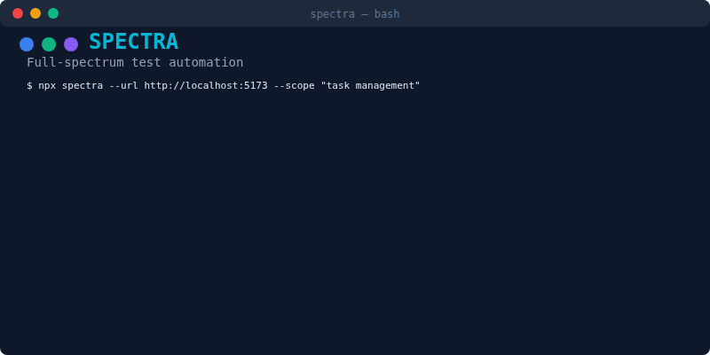
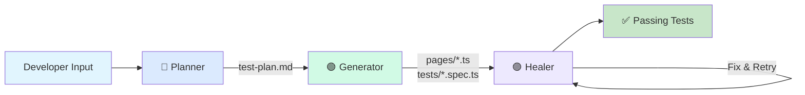

<div align="center">


# Spectra

### Full-Spectrum Test Automation

[](https://playwright.dev/)
[](https://www.typescriptlang.org/)
[](https://nodejs.org/)
[](https://opensource.org/licenses/MIT)

<br />

**One command. Complete coverage.**

Spectra uses AI agents to explore your app, generate Playwright tests, and automatically fix failures — all without manual intervention.

[Quick Start](#-quick-start) •
[How It Works](#-how-it-works) •
[Examples](#-examples) •
[Documentation](#-documentation)

<br />



</div>

---

## ✨ Features

<table>
<tr>
<td width="50%">

### 🔵 Multi-Agent Architecture
Three specialized AI agents work in harmony:
- **Planner** - Explores your app via browser
- **Generator** - Creates Page Objects & tests
- **Healer** - Runs tests and fixes failures

</td>
<td width="50%">

### 🎯 Feature Scoping
Test specific features, not entire pages:
```bash
spectra --url http://localhost:5173 \
  --page /checkout \
  --scope "payment form"
```

</td>
</tr>
<tr>
<td width="50%">

### 🟣 Self-Healing Tests
When tests fail, the Healer agent:
- Inspects current UI state
- Identifies what changed
- Automatically fixes locators
- Re-runs up to three times per test

</td>
<td width="50%">

### 📋 Page Object Model
Generates clean, maintainable code:
- Semantic locators (`getByRole`, `getByLabel`)
- Reusable Page Object classes
- Well-structured test files

</td>
</tr>
</table>

---

## 🚀 Quick Start

### Prerequisites

| Requirement | Version | Check |
|------------|---------|-------|
| Node.js | LTS (v22.x) | `node --version` |
| pnpm | Latest | `pnpm --version` |
| Git | Any | `git --version` |

### Installation

#### Option A: Install as npm package

```bash
# Install in your project
pnpm add -D spectra-test-automation @playwright/test

# Scaffold project structure
# (creates playwright.config.ts, .cursor/mcp.json, specs/ gate docs, pages/, tests/, fixtures/)
npx spectra-test-automation --init

# Install Playwright browsers
pnpm exec playwright install chromium
```

#### Option B: Install from Git

```bash
# Install directly from the repository
pnpm add -D "git+https://github.com/fifijo/spectra.git" @playwright/test
```

#### Option C: Clone and develop locally

```bash
git clone https://github.com/fifijo/spectra.git
cd spectra
pnpm install
pnpm run build
```

### Generate Your First Tests

```bash
# Start your web application (in another terminal)
cd /path/to/your/app && pnpm dev

# Run the seed spec to verify environment
npx playwright test tests/seed.spec.ts  # scaffolded by --init

# Run Spectra
npx spectra-test-automation --url http://localhost:5173
```

`spectra --init` creates `tests/seed.spec.ts` — a generic spec that checks that
the target URL answers and that the page has a title.

That's it! Check the `tests/` folder for your generated tests.

---

## 📖 How It Works

<table>
<tr>
<td align="center" width="33%">

### 🔵 Planner

Explores your application using Playwright MCP, documenting pages, elements, and user flows.

**Output:** `.spectra/output/plans/test-plan.md`

</td>
<td align="center" width="33%">

### 🟢 Generator

Reads the Plan and generates Page Object classes and test files.

**Output:** `pages/*.ts`, `tests/*.spec.ts`, `fixtures/pages.ts`

</td>
<td align="center" width="33%">

### 🟣 Healer

Runs tests, detects failures, inspects UI, and automatically fixes broken locators.

**Output:** `.spectra/output/reports/healing-report.md`, `.spectra/output/reports/status.json`

</td>
</tr>
</table>

### Agent Pipeline Flow



---

## 💡 Examples

### Full Spectrum Scan

```bash
npx spectra-test-automation --url http://localhost:5173
```

Spectra explores all accessible pages and generates comprehensive tests.

<details>
<summary>📸 See Example Output</summary>

```
   ◐ ◑ ◒
  SPECTRA
  Full-spectrum test automation
  ─────────────────────────────────

Mode: cursor-agent
Target: http://localhost:5173

═══════════════════════════════════════════════════════
  🔵 PLANNER
═══════════════════════════════════════════════════════

═══════════════════════════════════════════════════════
  🟢 GENERATOR
═══════════════════════════════════════════════════════

═══════════════════════════════════════════════════════
  🟣 HEALER
═══════════════════════════════════════════════════════

═══════════════════════════════════════════════════════
  ✨ SPECTRUM COMPLETE
═══════════════════════════════════════════════════════

Generated:
  Page Objects: 3
  Test files: 2

Commands:
  npx playwright test                                  Run all tests
  npx playwright test --ui                             Run with UI
  npx playwright show-report .spectra/output/reports   View report
```

Each Agent's own output — exploration, file writes, test runs — goes to
`.spectra/output/<agent>.log`. Add `--debug` to mirror it to the terminal.

</details>

### Single Page Focus

```bash
npx spectra-test-automation --url http://localhost:5173 --page /login
```

### Feature Scoping

When a page has multiple features but you only want to test one:

```bash
npx spectra-test-automation \
  --url http://localhost:5173 \
  --page /checkout \
  --scope "credit card payment form"
```

The Planner focuses only on the payment form, the Generator creates
`PaymentFormPage.ts` and `payment.spec.ts`, and the Healer runs and fixes only
payment-related tests. Everything else on the page is ignored.

### Scope File

For complex requirements, copy the template, edit it, and point Spectra at it:

```bash
cp docs/SCOPE-template.md SCOPE.md
npx spectra-test-automation --url http://localhost:5173 --file SCOPE.md
```

> The text of the scope file is read by the agent. See [Trust](#-trust).

### Multiple Scopes (Batch Mode)

Run several scopes one after another from a JSON config:

```bash
npx spectra-test-automation --batch scopes-batch.json
```

> See [BATCH-CONFIG.md](docs/BATCH-CONFIG.md) for the full JSON schema.

---

## ⚙️ Configuration

### CLI Options

| Option | Short | Description | Example |
|--------|-------|-------------|---------|
| `--url` | `-u` | Target URL (required) | `-u http://localhost:5173` |
| `--page` | `-p` | Specific page to test | `-p /checkout` |
| `--scope` | `-s` | Feature to focus on | `-s "payment form"` |
| `--file` | `-f` | Scope file path — see [Trust](#-trust) | `-f SCOPE.md` |
| `--batch` | `-b` | JSON file with scope definitions | `-b scopes-batch.json` |
| `--manual` | `-m` | Force manual mode (the prompt goes to your IDE) | `-m` |
| `--mode` | | Run the agents with this CLI | `--mode codex` |
| `--mcp` | | Serve the Spectrum over MCP | `--mcp --url http://localhost:5173` |
| `--init` | | Scaffold project structure | `--init` |
| `--debug` | | Enable debug output | `--debug` |
| `--help` | `-h` | Show help | `-h` |

### Environment Variables

| Variable | Description | Default |
|----------|-------------|---------|
| `SPECTRA_URL` | Base URL for tests | (none — required) |
| `SPECTRA_MODE` | CLI the agents run with | (the first one found) |
| `SPECTRA_BROWSERS` | Browsers to test (chromium,firefox,webkit,mobile,all) | `chromium` |
| `SPECTRA_TAGS` | Filter tests by tags (@smoke,@critical) | (all tests) |
| `SPECTRA_DEBUG` | Enable debug output | (unset) |

```bash
export SPECTRA_URL=http://localhost:5173

# Run without --url flag
npx spectra-test-automation
```

### Test Tags

Every generated test carries at least one tag:

| Tag | When to apply |
|-----|---------------|
| `@smoke` | Core happy-path scenarios that run on every deploy |
| `@critical` | Business-critical flows (payments, auth, data integrity) |
| `@e2e` | Full end-to-end multi-step journeys |
| `@slow` | Tests expected to take more than 10 seconds |
| `@validation` | Tests that verify form validation errors |
| `@empty` | Tests that verify empty state behavior |
| `@a11y` | Tests that verify keyboard navigation and accessibility |
| `@interaction` | Tests that verify toggle/checkbox/tab interactions |

Two more tags exist for triage, added by the Healer when it cannot make a
test pass: `@blocked` (the application is broken) and `@flaky` (the test
is timing-dependent). The Generator never emits them.

---

## 🔧 Modes of Operation

### Fully Automated (default)

When an agent CLI is installed, Spectra detects and uses it — `cursor-agent`,
`claude-code` (the `claude` binary), `codex`, `opencode`, or `gemini` — and runs
all three agents without intervention. With no CLI installed, the run falls back
to manual mode.

```bash
npx spectra-test-automation --url http://localhost:5173
```

When several CLIs are installed, name the one you want:

```bash
npx spectra-test-automation --url http://localhost:5173 --mode codex
```

### Native Mode (your own chat or CLI)

Serve the Spectrum over MCP and let the model in your chat or terminal play the
Agents:

```bash
npx spectra-test-automation --mcp --url http://localhost:5173
```

### Manual Mode

Force the run to write each Agent's prompt to
`.spectra/agents/<agent>/current-prompt.md` and wait for its completion signal:

```bash
npx spectra-test-automation --url http://localhost:5173 --manual
```

---

## 🔐 Trust

Spectra runs an AI agent on your machine. In automated mode the agent reads and
writes files in the project and runs commands there — that is how it writes
tests and runs them.

The trust boundary is the project folder:

- Only run Spectra in a project you trust. The agent reads the project it is
  pointed at, and your `playwright.config.ts` is already code that runs there.
- A scope file (`--file`) is read by the agent and treated as requirements to
  test. The text of a file from **outside** the project goes straight to the
  agent, so only use a file you trust. Spectra says so when the file is outside
  the project.
- In Native mode the model in your chat does the work, with the rights you gave it.

---

## 📚 Documentation

| Document | What it covers |
|----------|----------------|
| [WALKTHROUGH.md](docs/WALKTHROUGH.md) | Step-by-step guide with a detailed flow and examples |
| [QUICK-REFERENCE.md](docs/QUICK-REFERENCE.md) | Commands, env vars, test tags, key files, troubleshooting |
| [BATCH-CONFIG.md](docs/BATCH-CONFIG.md) | Batch JSON schema and examples |
| [SCOPE-template.md](docs/SCOPE-template.md) | Template for feature scoping |
| [CI-CD.md](docs/CI-CD.md) | GitHub Actions workflow for running tests in CI |
| [PUBLISHING.md](docs/PUBLISHING.md) | Publishing to npm and versioning |

---

## 🤝 Contributing

Contributions are welcome!

1. Fork the repository
2. Create your feature branch (`git checkout -b feature/amazing-feature`)
3. Install dependencies: `pnpm install`
4. Build: `pnpm run build`
5. Commit your changes (`git commit -m 'Add amazing feature'`)
6. Push to the branch (`git push origin feature/amazing-feature`)
7. Open a Pull Request

---

## 📄 License

This project is licensed under the MIT License - see the [LICENSE](LICENSE) file.

---

## 🙏 Acknowledgments

- [Playwright](https://playwright.dev/) - Browser automation framework
- [Anthropic Claude](https://anthropic.com/) - AI assistance
- [Model Context Protocol](https://github.com/anthropics/anthropic-cookbook/tree/main/misc/model_context_protocol) - MCP standard
- [Cursor](https://cursor.com/) - AI-powered IDE

---

<div align="center">

**[⬆ Back to Top](#spectra)**

<br />

◐ ◑ ◒

**Spectra** — Full-spectrum test automation

Made with ❤️ by developers, for developers

</div>
